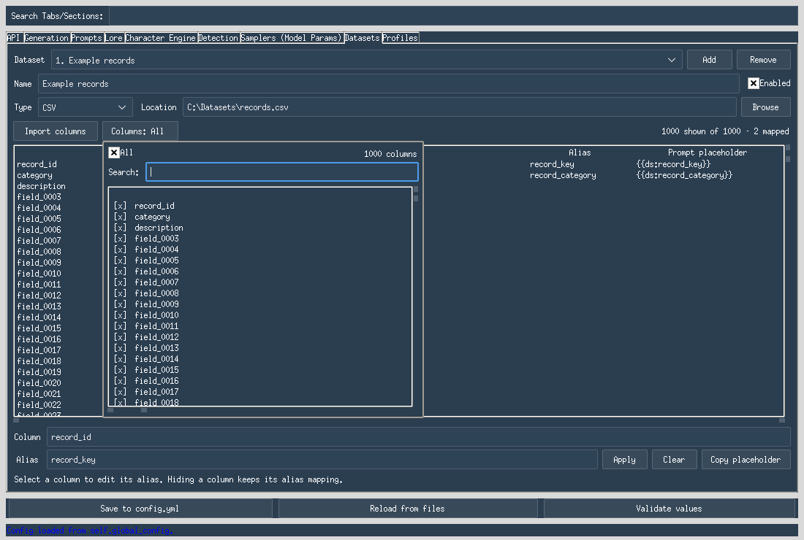

# Dataset bindings: sources, configuration, and validation

This branch adds dataset sources, a **Datasets** configuration tab, and generation
worker integration. Configured aliases can be inserted into authored prompt fields
as `{{ds:alias}}`. Each logical job keeps its assigned rows through subsequent turns,
cleanup calls, API duplication, retries, and recovery. The default configuration
has `datasets: {sources: []}` and uses the existing prompt-generation path.

## Datasets tab

1. Open the Configuration Editor and select **Datasets**. Use **Add** for each
   source. The source selector keeps the layout bounded as more sources are added.
2. Choose the source type and location. Hub sources also expose configuration,
   split, and revision; a saved DatasetDict exposes its split selector.
3. Choose **Import columns**. Metadata discovery runs in background workers.
   The panel displays column names, aliases, and placeholders, never record cells.
4. Select a column and enter an alias such as `record_key`. **Apply** saves it;
   **Copy placeholder** copies `{{ds:record_key}}`. An empty alias leaves a column
   unmapped. Aliases must be unique among enabled sources.
5. Save through **Save to config.yml** or a named profile. Source definitions,
   imported names, aliases, and visibility choices survive reloads.
6. Insert the copied placeholders into the relevant prompt fields and start a
   generation run. The existing questions, random-chunk, and opening-mode queue
   controls still determine how many jobs are created.

### Many-column layout and visibility

The mapping table has a bounded viewport with vertical and horizontal scrollbars.
It uses native rows and one selected-column editor, rather than a widget per
column. Long column names remain available in the selected-column field.

**Columns: All** is the default for each source. Its dropdown has a bounded,
scrollable list, individual toggles, a search field, and an **All** control.
The markers `[x]` and `[ ]` use plain characters so selection remains visible
even when a system font lacks checkbox symbols. Mouse clicks and Space toggle
rows; Escape or clicking outside dismisses the menu.

Search only filters the dropdown list. It does not change selections, and **All**
applies to the entire schema. Hiding a column preserves its alias and keeps that
mapping active. Each source retains its own visibility settings. All also includes
new names imported later; an explicit partial selection retains its surviving
names after refresh.




These are captures of the actual editor under a Linux virtual display. Fonts,
window decorations, and native control rendering can differ on Windows.

### Drafts, refresh, and saving

Disabled sources and sources with no aliases may be saved as unfinished drafts.
Enabled sources with mappings require an imported schema matching the current
location/config/split/revision settings. Editing those selectors requires another
import before saving active mappings. A refresh that would remove a mapped column
is rejected; clear that alias in the retained table before retrying.

Both main-configuration and profile saves validate these rules. If autosave on
window close fails, the editor stays open with the validation message and all
unsaved changes preserved. Loading or saving settings performs no dataset I/O.
Pending metadata results are discarded after changing selectors, switching or
removing sources, reloading settings, or closing the panel.

## Placeholder syntax

Use `{{ds:alias}}`, for example `{{ds:nvd_f_name}}`. The GUI stores the
alias alone (`nvd_f_name`), independently of the exact source column name.
Aliases are case-sensitive and match `[A-Za-z_][A-Za-z0-9_]*`. They must be unique
across the sources used in a run.

The `ds:` namespace separates dataset variables from the existing `{context}`,
`{subject}`, and other single-brace variables. A renderer receives both kinds
of values and scans the original template once. Inserted text is never scanned
again, even if it contains either placeholder syntax. Unknown dataset aliases
and malformed reserved placeholders are errors. Unrelated braces, JSON, pipes,
and tags are preserved. There is no escape syntax for a literal dataset token
in an authored template at this stage; such tokens in inserted values are literal.

Rendering happens where a stage has both its native values and the job's dataset
binding. With datasets active, native and dataset placeholders are substituted in
one pass; generated text and conversation history never become templates. With
no active dataset mappings, the original replacement behavior is retained.

Supported authored fields include system variations, top-level system text, lore,
selected character text fields, random names, emotional-state entries, question
and answer instructions, user continuations, opening greetings/context/first-line
styles, and configured rewrite instructions. Quality scoring consumes the resulting
conversation literally. Questions-file entries and source-file chunks also remain
literal inputs; use the configured prompt fields for dataset placeholders.

For example, map `first_name` to `person_name` in one source and `location` to
`scene_place` in another, then use:

```text
Write about {{ds:person_name}} arriving at {{ds:scene_place}}.
Use this existing source context: {context}
```

Every mapped field from the first source comes from one person row. Every mapped
field from the second comes from one location row. A later cleanup or continuation
request for that job uses the same pair.

## Source interface

`dataset_sources.py` exposes immutable `SourceSpec`, `DatasetSchema`, and
`DatasetRow` records, plus `open_source(spec)`.

| Kind | Input | Discovery / reading |
| --- | --- | --- |
| `csv`, `tsv` | UTF-8 file, with optional BOM | Read exact header names; stream rows |
| `jsonl` | One JSON object per nonblank line | Scan keys across all rows; stream rows during binding |
| `json` | A JSON array of objects | Load the array in memory; prefer JSONL for large inputs |
| `parquet` | Local Parquet file | Schema metadata; batched rows; optional PyArrow |
| `huggingface` | `owner/dataset` plus config/split/revision | Pin the repository to a commit; schema metadata and streamed rows; optional Datasets backend |
| `hf_disk` | Directory created by `Dataset.save_to_disk()` | Select one saved DatasetDict split or a single Dataset; optional Datasets backend |

Creating a source opens nothing. `source.schema()` returns column names and
metadata, never row values. JSON key discovery must read the file, but does not
retain values in the returned schema. The panel runs discovery off the GUI thread.
The file readers handle exact top-level column names; dotted names are literal
columns, not nested field paths. Nested JSON cells serialize as JSON when bound.

Paths, quotes, backslashes, and exact column names are preserved. This code does
not use the application's destructive input sanitizer. Duplicate headers/keys,
wrong row shapes, missing mapped fields, and unsupported cell types are explicit
errors. Sparse JSON records can expose a column in their schema but still fail
if a selected record lacks that mapped column.
Opening a CSV/TSV source raises Python's process-wide CSV field-size limit to
accommodate long text cells; importing this module alone does not change it.

Local fingerprints use file identity, size, and modification time (saved
directories use a file list with sizes/times). They detect ordinary edits, not
all possible content changes. Already-bound values remain valid after a source
changes; attempting to read further rows from a changed local source fails.
Remote schemas carry the resolved commit/config/split as well as a fingerprint.
Remote files outside the repository may have their own mutability limitations.

Hub sources require supported data files and declared feature metadata at the
chosen revision. There is no fallback to a different revision or a preview row
if metadata is missing. Multiple configurations/splits require an explicit choice.
These are text/tabular readers; no automatic image/audio-to-text conversion is
provided. Streaming can still download a full file for some underlying formats.

## Per-job ownership

```python
from dataset_sources import SourceSpec, open_source
from dataset_bindings import DatasetBindingManager, SourceBinding, TaskBinding
from dataset_templates import render_template

people = open_source(SourceSpec("people", "csv", "people.csv"))
content = open_source(SourceSpec("content", "jsonl", "content.jsonl"))

with DatasetBindingManager("unique-run-id", [
    SourceBinding(people, {"first_name": "first", "last_name": "last"}),
    SourceBinding(content, {"body": "body"}),
]) as bindings:
    job = bindings.bind("unique-job-id")
    prompt = render_template(
        "{{ds:first}} {{ds:last}}: {{ds:body}}\n{context}",
        job.values,
        {"context": "The stage's existing context."},
    )
    assert bindings.bind("unique-job-id") is job
    restored = TaskBinding.from_dict(job.to_dict())
    assert restored.values == job.values
```

Supply any number of sources, with globally unique source IDs and aliases.
Only mapped/enabled sources belong in the manager. Each source contributes its
next row to each new job; every mapped column from that source comes from that
one row. Sources have separate cursors. This first policy pairs their sequential
positions; it does not perform joins, Cartesian products, random sampling, or
silent cycling. Exhaustion fails clearly.

Allocation is coordinated across workers, while rendering and model requests
take place after the allocation lock is released. Candidate rows are staged
until all sources succeed. Repeated `bind(job_id)` calls return the original
immutable values; they do not allocate new rows. Source readers and manager
instances belong to one run and must not be shared between runs. Job IDs must
uniquely identify logical generation items, regardless of worker or API slot.

Strings are preserved verbatim. Top-level null becomes an empty string. Other
JSON-compatible cells become compact JSON with sorted object keys and Unicode
preserved. Nulls inside JSON stay `null`; booleans become `true`/`false`.
Non-finite numbers and Python-only objects fail rather than using their repr.

`TaskBinding.to_dict()` stores actual mapped strings, mappings, row IDs, and source
provenance. `from_dict()` restores that binding without reading sources.
`DatasetBindingManager.from_bindings()` accepts bindings in their original
allocation order. Existing jobs immediately reuse their saved values. The first
new allocation reopens the saved resolved sources, requires matching fingerprints,
and replays every committed row ID and mapped value before advancing. It never
seeks by numeric row ID: formats can skip physical rows.

`manager.close()` releases readers while keeping existing bindings readable;
new allocations are then prohibited.

## Run persistence and lifecycle

`dataset_runtime.DatasetRun` owns the frozen dataset settings, original queued
task tuples, and durable bindings for one run. Workers receive that particular
runtime as an argument. They do not look up a replaceable global row or infer
ownership from an API slot. Each newly queued dataset job gets a run ID plus a
unique ordinal, even when two original input samples happen to be identical.

Rows are allocated sequentially in binding order, which can differ from queue
order when workers run concurrently. Allocation and checkpoint writes are
serialized; prompt construction and model calls take place after that lock is
released. Repeated allocation calls for a job return its original immutable values.

Before workers start, the tool seals a manifest containing the original job inputs
and frozen source settings. Before a job's first request, it atomically saves that
job's mapped values and source provenance. Only mapped dataset values are retained.
Records live under `output/dataset_runs/<run_id>/`; the usual
`output/generation_state.json` contains a small reference and current job statuses.
The manifest is written once and each binding has its own file, avoiding repeated
rewrites of all input passages as jobs finish.

Binding records carry allocation order and checksums; a small allocation frontier
detects missing committed records. Recovery can adopt one complete record left by
an interruption immediately before its frontier update, after validating it.
Incomplete or inconsistent checkpoints fail explicitly. These files contain the
actual inputs and mapped dataset values and belong with the run's other output.
API credentials are not included in the dataset checkpoint.

On restart, the saved job catalog supplies the original inputs. Already-bound jobs
can run even if their original input files or dataset sources are unavailable.
Assigning a row to a previously unbound job requires successful source replay and
verification. A missing, changed, exhausted, or malformed source prevents new
assignments; already-bound jobs retain usable values and can finish.

Settings edits during a run do not replace its dataset mappings. Resuming requires
matching active source settings, aliases, and the saved critical run settings;
GUI-only name/visibility changes are allowed. Invalid recovery state is preserved
and blocks saving over it. Restore the matching settings or use the explicit
**Stop & Clear Job** action to start a new run. Stop & Clear removes the loaded
run's dataset checkpoints after its workers exit. Other run directories are
retained, including an older directory whose checkpoint could not be loaded.

Completion and shutdown retain references to the actual workers until they exit.
Starting a replacement run is blocked while old workers or cleanup remain active.
Manual retry resets retry counts and keeps the original job payload and binding.

Recovery restarts an unfinished conversation from its first request. It does not
resume inside a model request or a partially completed conversation, and does not
make output writes transactional. In duplication mode, a partially successful job
is marked failed while already-written per-API outputs remain; explicitly retrying
it can repeat those outputs. Fully successful duplicated jobs are marked completed.

## Optional dependencies and compatibility boundary

All foundation modules and CSV/TSV/JSON/JSONL readers use Python's standard
library and remain compatible with the application's Python 3.8 language target.
Optional packages are imported only when their reader is used. The normal
`requirements.txt` installation does not include Hugging Face or PyArrow.

The optional installation includes both the application and dataset dependencies:

```sh
python -m pip install -r requirements-datasets.txt
```

This requires Python 3.9 or later and pins `datasets==4.4.2`. Its dependencies
include PyArrow, so it covers local Parquet and saved-HF folders too. Datasets
4.x does not execute dataset scripts. Later releases can raise the Python minimum,
which is why the tested optional backend is pinned explicitly here.

The application's Requests requirement is now `requests>=2.32.4,<3`, resolving
the conflict between its former `2.31.0` pin and Datasets' `>=2.32.2` requirement.
Pip can select a release compatible with the interpreter: Requests 2.32.4 supports
Python 3.8; newer releases raise that minimum. This preserves the normal Python
3.8 installation path without silently omitting the optional backend if someone
tries to install it on an unsupported interpreter. The combined install and
existing application regressions were tested on Python 3.12, not every interpreter.

Authentication uses Hugging Face's normal environment or saved-login mechanism;
no access token is included in source settings or binding snapshots. No login,
Hub request, or model API call occurs just by importing these modules.

Primary API references:

- [Datasets 4.0 loading and streaming API](https://huggingface.co/docs/datasets/v4.0.0/package_reference/loading_methods)
- [Datasets 4.4.2 declared dependencies](https://github.com/huggingface/datasets/blob/4.4.2/setup.py)
- [Hugging Face repository metadata API](https://huggingface.co/docs/huggingface_hub/package_reference/hf_api#huggingface_hub.HfApi.dataset_info)
- [Requests release and Python support history](https://requests.readthedocs.io/en/latest/community/updates/)

## Verification and next boundary

Run the dependency-free foundation checks with:

```sh
python -B -m unittest test_dataset_sources test_dataset_bindings test_dataset_templates test_dataset_settings test_dataset_pipeline
```

After installing the optional requirements, also run the real local backend tests:

```sh
python -B -m unittest test_dataset_backends
```

Those tests use actual Parquet files and `Dataset.save_to_disk()` fixtures. They
skip explicitly when optional packages are absent; a skipped suite does not
count as backend validation. All automated suites avoid network and model calls.

A live Hub check is deliberately opt-in and displays names/provenance, not cells:

```sh
python -B tools/check_dataset_hub.py --repository cornell-movie-review-data/rotten_tomatoes --config default --split train --column text --column label --rows 2
```

### Step 2 evidence (2026-10-28)

The isolated Linux/Python 3.12.14 environment resolved Requests 2.34.2, Datasets
4.4.2, PyArrow 26.0.0, and huggingface-hub 1.33.0. `pip check` reported no broken
requirements. The combined requirements installed in a clean temporary environment.

- 48 foundation tests cover exact columns, correlated rows, immutable bindings,
  source exhaustion/edits, snapshot serialization, concurrency, and literal text.
- 13 tests used real Parquet and saved-HF fixtures, including a Parquet batch
  boundary, saved NumPy formatting, DatasetDict splits, and reader closure.
- 7 orchestration simulation tests exercised six request stages, transient
  failures, whole-job handoff, caching, and source-free snapshot replay.
- Twenty concurrent jobs produced 120 simulated requests while consuming exactly
  twenty rows per source. Twenty concurrent callers for one job consumed one row
  per source; binding reuse is distinct from deduplicating job scheduling.
- Request retries reused identical serialized bodies. A failed job retained its
  binding when another live worker processed a different job before retrying it.
- Saved binding plus original job payload reproduced the original requests after
  source files were removed. This is replay of a job, not continuation recovery.
- The live Hub check read two rows successfully from the public test repository
  at revision `aa13bc287fa6fcab6daf52f0dfb9994269ffea28`, retaining its `default`
  configuration, `train` split, and `text`/`label` columns through binding/replay.
- The existing API-profile, persona/arc, and opening-mode regression scripts pass
  with the combined dependency environment. The opening-mode script contained a
  stale legacy-output fixture in the upstream baseline: it expected no metadata
  while the writer already defaulted to including it. Its one legacy-format call
  now explicitly sets `include_metadata=False`; production output is unchanged.

The orchestration harness is explicitly a simulation using the actual source,
binding, and rendering modules. It does not test their integration into
`generation.worker`, application recovery, or the production cache, because
those hooks are not wired yet. Existing regression scripts exercise the current
worker independently. No paid model calls, GUI interaction, Windows execution,
repository push, or PR was part of this validation checkpoint.

### Step 3 evidence (2026-10-28)

All 89 non-GUI dataset tests passed, including 21 settings tests and the optional
local backends, with no skips. The existing API-profile, persona/arc, and
opening-mode scripts also passed: 28, 45, and 179 checks respectively.

Run the actual Tk GUI suites separately with the normal application dependencies
and a desktop or virtual display:

```sh
python -B -m unittest test_dataset_column_menu
python -B -m unittest test_datasets_panel
```

All seven dropdown tests and all seven panel/editor tests passed with no skips.
Together with the non-GUI suites, that is 103 dataset tests. The GUI checks used
Linux, Python 3.12.14, Tk 9.0.4, and ttkbootstrap 2.2.6. They exercised:

- 1,000 columns, including very long names, with constant widget counts and
  bounded table/dropdown geometry. The full editor was checked at 760 by 520 and
  1366 by 700 client sizes; 32 sources were added and retained in the panel.
- All/partial/empty visibility, search, mouse and keyboard toggles, focus/grab
  restoration, menu dismissal, and source-specific visibility persistence.
- Background CSV metadata discovery with a responsive Tk event loop, reader
  closure, no row iteration requested by the GUI, and no record cells in settings.
- Late/out-of-order results, source switching/removal, settings reload, and panel
  destruction while metadata requests were outstanding.
- Exact placeholder copying, hidden alias retention, schema refresh rejection,
  actual profile save/load, main configuration save, and preservation of unsaved
  changes when validation blocks window-close autosave. Disabled drafts save intact.

`READYART_GUI_SCREENSHOTS` optionally gives the panel suite a screenshot directory.
Visual review caught missing Unicode checkbox glyphs; the dropdown now uses the
portable markers shown above. No model API calls were used for these checks.
Windows hands-on verification remains outstanding.

### Step 4 worker integration evidence (2026-10-28)

The production-path checks use the actual generation worker, request builders,
rewrite loops, output writer, local dataset sources, and durable runtime. HTTP
responses are simulated; cache access, rate limiting, and timing boundaries are
controlled by the existing test harness. No paid model requests are used.

The final isolated Linux/Python 3.12 pass completed with no skips:

| Suite | Result |
| --- | --- |
| Sources, bindings/restoration, templates, settings, pipeline simulation, real optional backends, durable runtime | 112 tests passed |
| Production generation worker and request paths | 11 tests passed |
| Application startup, recovery, retry, and shutdown lifecycle | 25 tests passed |
| Existing API-profile, persona/arc, and opening-mode regression scripts | All passed |

That is 148 non-GUI dataset tests at this checkpoint. The 14 real Tk tests and
screenshots in Step 3 cover the unchanged Datasets panel and column picker.

Run the production-worker and lifecycle suites in separate processes because the
existing generation harness installs module-level mocks and a temporary working
directory:

```sh
python -B -m unittest test_dataset_runtime
python -B test_dataset_generation.py
python -B -m unittest test_dataset_lifecycle
```

The runtime checks cover concurrent assignment, source-free retries, verified next
row recovery, write failure, record integrity, interruption recovery, and precise
checkpoint cleanup. The worker checks exercise twenty simultaneous jobs, multiple
turns and rewrite passes, HTTP/whole-job retries, literal inserted text, previews
and cache inputs, opening/character prompts, API duplication, and source exhaustion
while already-bound work remains in flight. Lifecycle checks exercise actual
application functions with GUI handles replaced by test stand-ins.

Windows hands-on verification remains the next review gate before an upstream PR.
